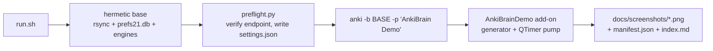

# AnkiBrain demo capture pipeline

Boots a **real Anki** in a hermetic base folder with the add-on installed,
drives the add-on's own UI through its real code paths (real endpoint, real
local engine, real Kokoro TTS, real card insertion into a real collection),
and captures PNGs into `docs/screenshots/`.

Every shot is the whole Anki window - the main window with the AnkiBrain
sidebar docked next to it - so the screenshots show the real application and the
panel together. Nothing touches the user's collection, settings or add-on
folder: the base is `demo/out/anki-base` (gitignored) and only
`docs/screenshots/` is committed.



## Prerequisites

- **Anki closed** (one Anki per OS user; the pipeline aborts otherwise).
- `anki` on `PATH`; `yarn`/corepack available if `webview/dist` is stale.
- The LOCAL engine and the voice engine both report `supported-and-installed`
  in the working checkout
  (`python3 -m local_engine.state --status`), with `user_files/.env` holding an
  `OPENAI_API_KEY` the endpoint accepts.
- X11 capture tooling: ImageMagick `import` (fallback: in-process
  `QWidget.grab()`; pick the backend with `demo/config.json`).

## Commands

| command | what it does |
| --- | --- |
| `./run.sh` | the `main` pass, then a manifest summary |
| `./run.sh --pass main` | the same, explicitly |
| `./run.sh --only talk-answer` | one shot plus its `after` closure |
| `./run.sh --skip-ai` | drop shots tagged `ai` (no API calls) |
| `./run.sh --list` | print the shot registry |
| `./run.sh --probe` | capture the same surface with both backends, write `demo/out/probe/report.json` and record the winner in `demo/config.json` |

Logs: `demo/out/logs/<pass>.stdout.log` (Anki's stdout, including every
`[demo]` line), `demo/out/logs/<pass>.json` (per-shot records + gate state),
`demo/out/logs/failures/<order>-<id>.png` (capture of a failed shot). A pass is
done when `demo/out/logs/<pass>.done` exists.

## Layout

```
demo/
  run.sh              orchestrator: preflight -> base -> Anki -> summary
  preflight.py        endpoint verification, settings.json generation, reports
  shots.json          the shot registry (coverage contract)
  config.json         capture backend + window/dock defaults for the shots
  addon/              copied into the base as addons21/AnkiBrainDemo/
    driver.py         generator + QTimer pump, stable-frame capture, manifest
    capture.py        capture backends (x11 / QWidget.grab)
    steps.py          named Anki-side steps
    seed.py           deterministic filler decks
  steps/panel/*.js    panel step files (prelude + step, one concern each)
  fixtures/           build_fixtures.py -> figures.docx + labelled figures
  out/                gitignored scratch: base, logs, probe, fixtures
```

## How a shot works

`shots.json` entries are one-shot recipes:

```json
{"id": "talk-answer", "title": "Talk — answer with the model footer",
 "feature": "Talk", "pass": "main", "order": 9, "tags": ["ai"],
 "stages": [{"panel": ["talk/open.js", "talk/send_prompt.js"],
            "wait_js": "!!document.querySelector('.AIMessage')", "timeout": 240}]}
```

- `order` is the row in the docs tables; the file is
  `docs/screenshots/<order:02d>-<id>.png`. Orders must be unique and contiguous
  per pass.
- Every shot captures `mw` itself, so the image is the whole application
  (main window + docked sidebar). `config.json`'s `defaults.window` /
  `defaults.dock` size it; a shot may override either.
- A capture repeats until two consecutive frames are byte-identical (up to 10
  frames), because a Chakra drawer or modal fades in over ~200ms and a single
  capture can catch the layer behind it showing through. A frame that never
  settles (an animating spinner) keeps the last one.
- `anki` steps run before the panel steps, so a file picker can be armed
  (`answer_file_dialog`) before the panel step that clicks the picker.
- `stages: [{anki, panel, wait_js | wait_ms}]` for interactions that need a
  wait *between* clicks (wait for the answer, then expand its accordion).
- `panel_after` / `anki_after` / `after_js` run after the capture: they put the
  app back where the next shot expects it (close the modal, unsuspend cards).
- `tags` gate a shot on the environment: `ai` (verified endpoint), `vision`
  (model supports images), `tts` (voice engine installed), `docs` (local engine
  installed). A shot whose tag is unmet is recorded as `skipped` with the
  reason — never as a silent pass.
- Paths in `anki` args may use `{repo}` (checkout root) and `{demo}` (this
  directory).
- `probe_js` runs one JS expression after the stages and logs its value: the
  hook for checking what a surface really contains while tuning a shot's waits.
- `keep_toasts` keeps the Chakra toasts the shot triggered: by default they are
  dismissed before the capture, because a toast renders over the whole sidebar.
  A shot whose subject *is* a toast (`makecards-add-to-anki`) opts out.

Panel steps are JS files under `steps/panel/`, run in the page with the
`_prelude.js` helpers (`demo.nav`, `demo.click`, `demo.clickText`,
`demo.setValue`, `demo.selectContaining`, `demo.toggleCheckbox`, `demo.inject`).
A step that throws fails its shot. Steps that depend on something happening
later (a debounced selection popup, a modal file dialog) arm a poller that the
driver waits for before it captures, so a shot can never be recorded against a
state that had not arrived yet; `wait_for(..., then=...)` chains those waits
(settle the surface, then act on it).

## The shot set

One pass, `main`, booting Anki in LOCAL mode with the endpoint verified by the
driver through the app's own `check_openai_endpoint`. The set is the app's key
features, in the order they are reached:

| feature | shots |
| --- | --- |
| Make Cards — text | `makecards-text-cards`, `makecards-review-list` |
| Make Cards — audio generation | `makecards-card-audio` |
| Make Cards — textbooks (documents) | `makecards-documents-staged` |
| Make Cards — images | `makecards-images-library` |
| Make Cards — auto occlusion | `makecards-occlusion-ai` |
| Make Cards — into the collection | `makecards-add-to-anki` |
| Explain | `explain-answer` |
| Talk | `talk-answer` |
| Reviewer highlight | `anki-reviewer-selection` |
| Local mode + endpoint | `settings-engine` |
| TTS engine | `settings-voice` |

Shots run in order and share one Anki session, so the earlier ones leave the
state the later ones need (text cards before the card list, staged figures
before the image library, cards in the deck before the reviewer).

## Adding a shot

1. Pick the next free `order` in the pass and add the entry to `shots.json`.
2. Write the panel step file(s) under `steps/panel/<feature>/`; use the prelude
   helpers and throw on anything unexpected (`demo.clickText` already lists what
   it saw).
3. Make `wait_js` assert the state the shot is *about* (not a weaker proxy), and
   set `timeout` for shots that call the model or the voice engine.
4. `./run.sh --only <id>` and look at the PNG before committing it.
