# AnkiBrain screenshots

Generated by `demo/run.sh` from a real Anki session. Do not edit by hand.

| Screenshot | Shot id | Feature | What it shows |
| --- | --- | --- | --- |
| 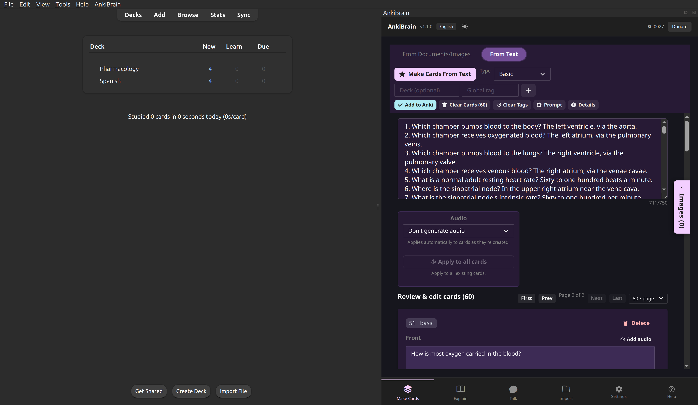 | `makecards-text-cards` | Make Cards (text) | Make Cards — cards generated from a text passage |
| 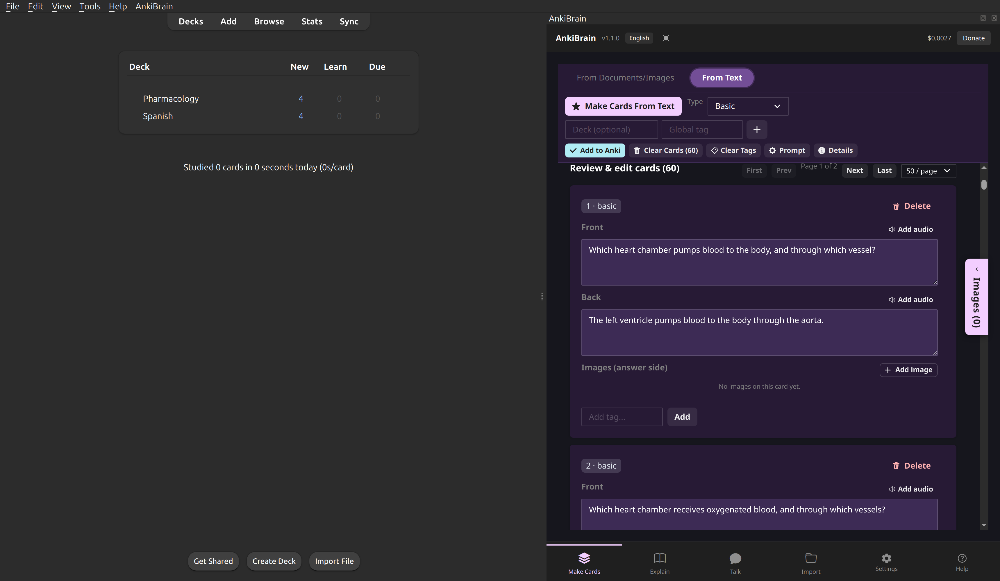 | `makecards-review-list` | Make Cards (text) | Make Cards — the generated card list |
| 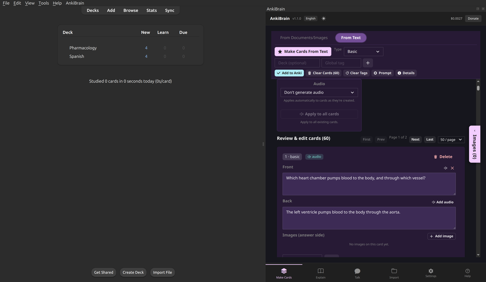 | `makecards-card-audio` | Make Cards (audio) | Make Cards — per-field audio from the voice engine |
| 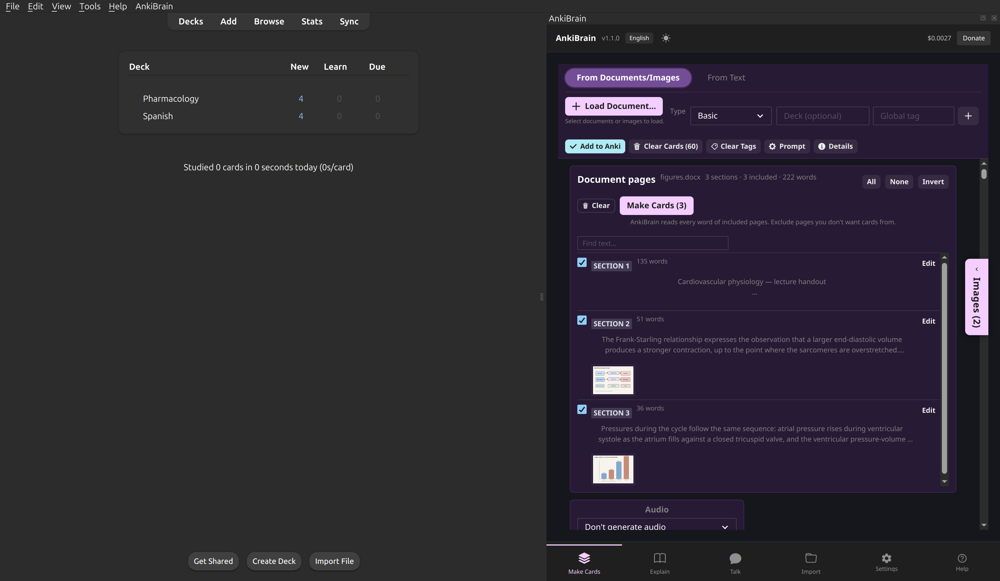 | `makecards-documents-staged` | Make Cards (textbooks) | Make Cards — a textbook split into staged pages |
| 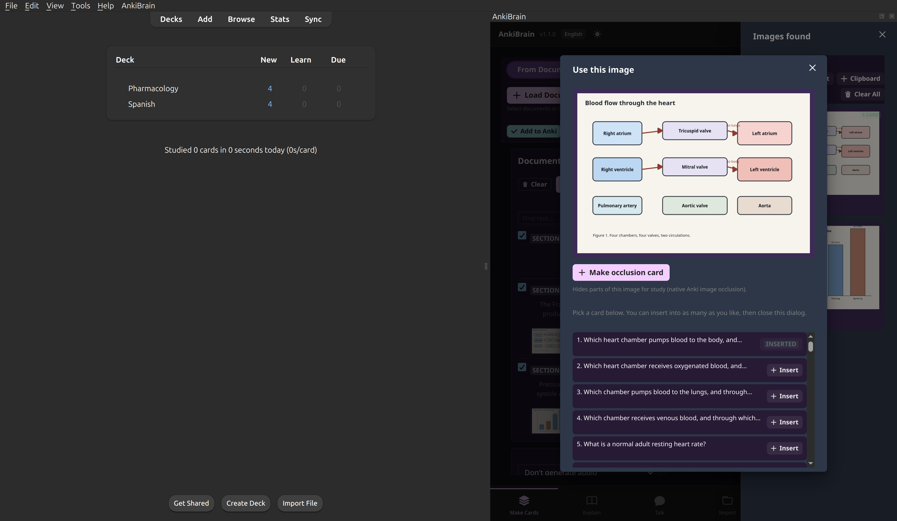 | `makecards-images-library` | Make Cards (images) | Make Cards — image library, figure on a card |
| 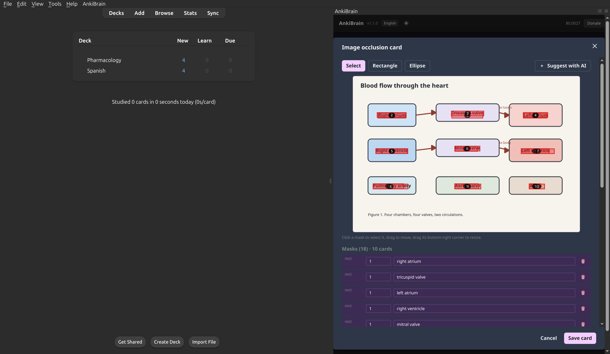 | `makecards-occlusion-ai` | Make Cards (auto occlusion) | Image occlusion — masks proposed by the vision model |
| 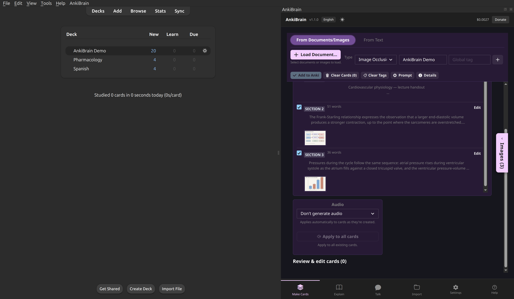 | `makecards-add-to-anki` | Make Cards | Make Cards — the cards added to the deck |
| 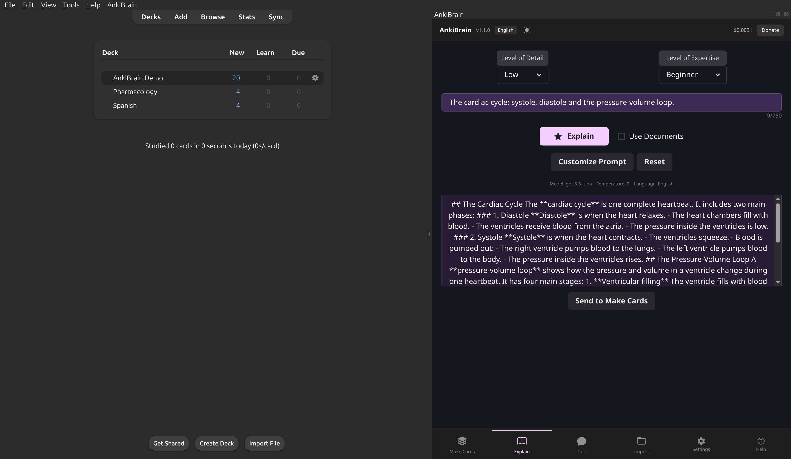 | `explain-answer` | Explain | Explain — topic explanation |
| 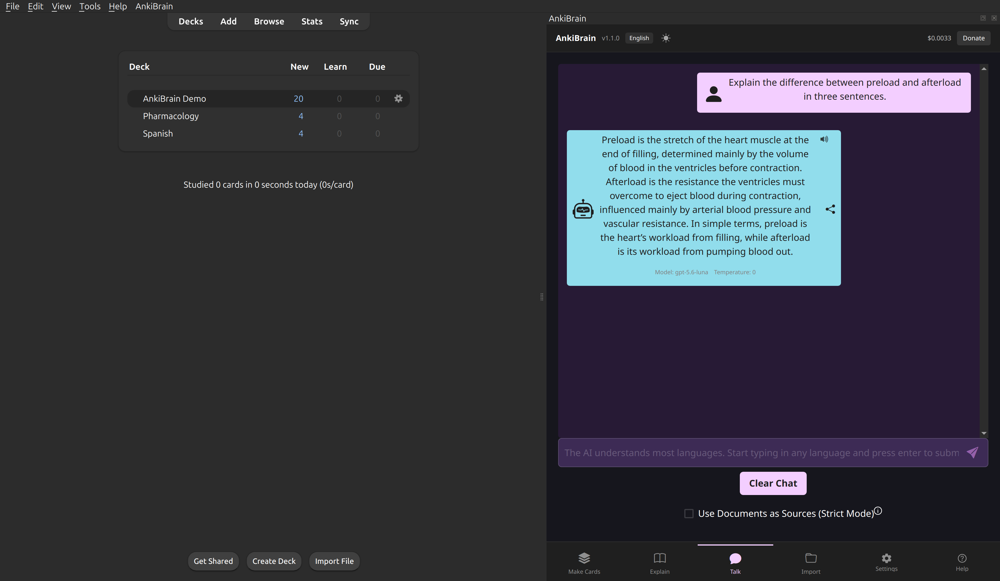 | `talk-answer` | Talk | Talk — answer with the model footer |
| 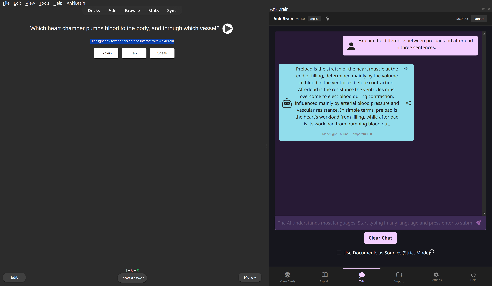 | `anki-reviewer-selection` | Reviewer | Reviewer — highlight card text to interact |
| 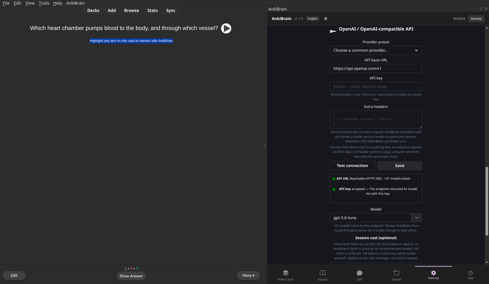 | `settings-engine` | Local mode | Settings — local mode endpoint (base URL, key, test) |
| 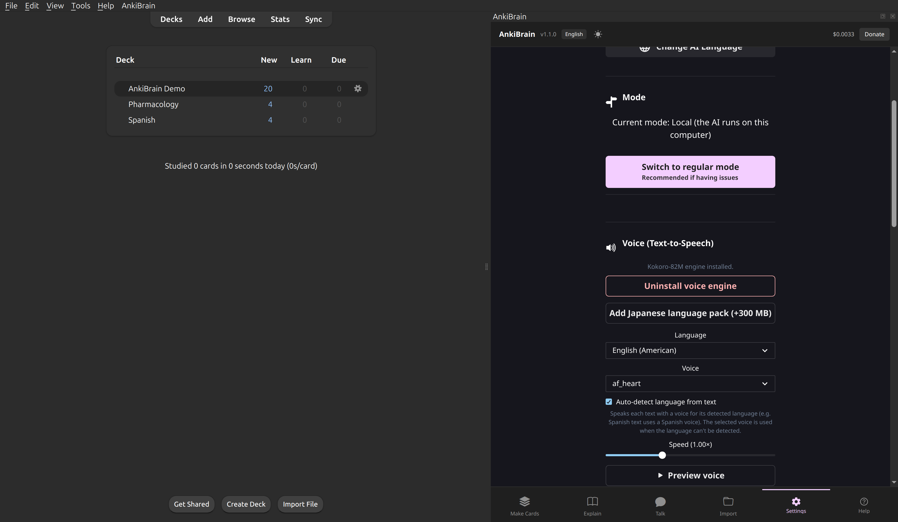 | `settings-voice` | TTS engine | Settings — voice (Text-to-Speech) engine |
